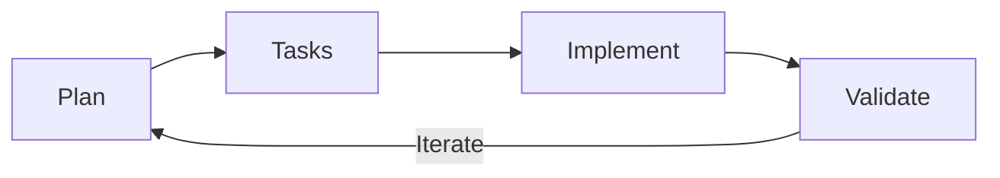

# Spec-driven development

## What is spec-driven development?
Spec-Driven Development (SDD) is an approach that puts **specifications** at the center of the development process.

The main idea is to use a **shared specification to guide both humans and AI agents** through planning, implementation, and validation.

SDD is not a new concept, but it has become more important with the rise of AI coding agents. These agents can now use specifications to break down tasks, generate code, run tests, and debug issues.

## How to use SDD in development

Two useful tools for SDD are:

- GitHub Spec Kit: https://github.github.com/spec-kit/index.html
- Kiro: https://kiro.dev/docs/specs/feature-specs/

The core workflow is:

**Spec → Plan → Tasks → Implement → Validate**

- Spec: Define what to build, including requirements and expected behavior.
- Plan: Decide how to build it, including technical design.
- Tasks: Break the plan into smaller, actionable tasks.
- Implement: Build the solution based on the specification.
- Validate: Check whether the implementation meets the requirements, and refine it if needed.

One important step is to review the specification before implementation.

A good specification should be clear, complete, consistent, and testable.

## Example and tutorial

A practical tutorial to explore SDD:
https://youtu.be/16IIi5uNx_M

## How to apply SDD to data science projects

SDD is especially useful for well-defined and repeatable tasks in Data Science projects.

Good use cases:

- Data pipelines: Define data schemas, transformation rules, and validation checks.
- Feature engineering: Specify feature definitions and expected outputs.
- MLOps: Automate model deployment, monitoring, and testing based on clear requirements.
- Model evaluation: Implement predefined metrics and evaluation procedures.

Less suitable for:

- Exploratory Data Analysis (EDA): Insights and hypotheses are often unknown in advance.
- Research and experimentation: Finding the best features, models, or algorithms requires exploration and human judgment.